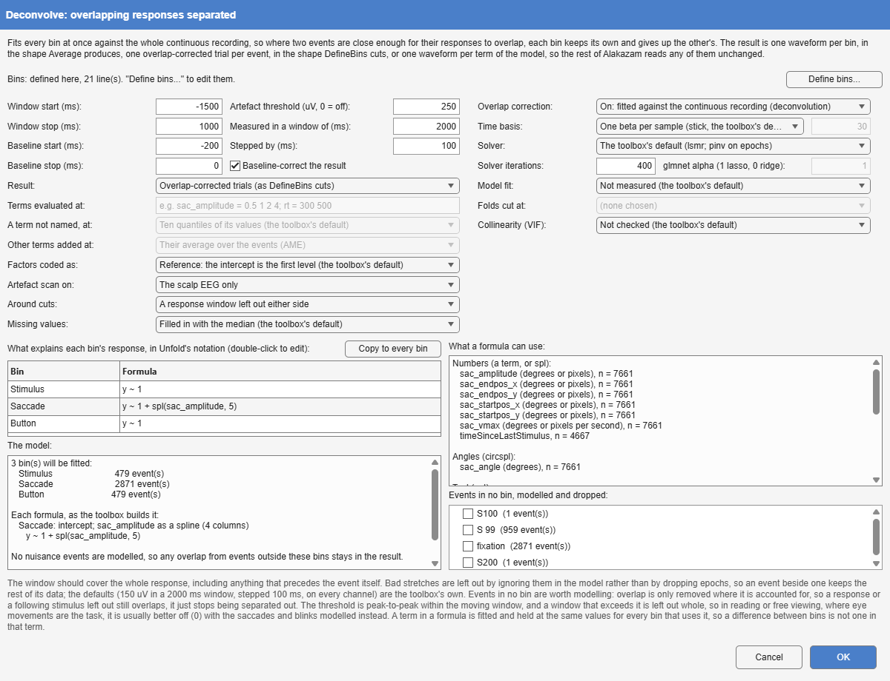
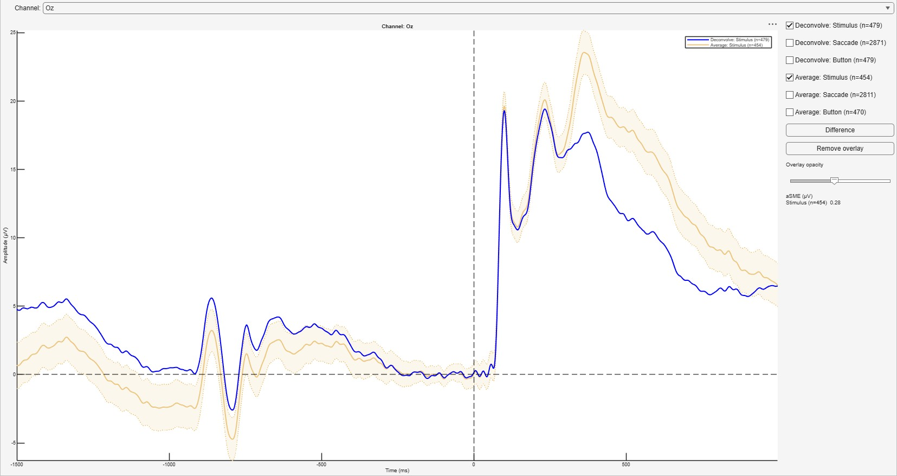
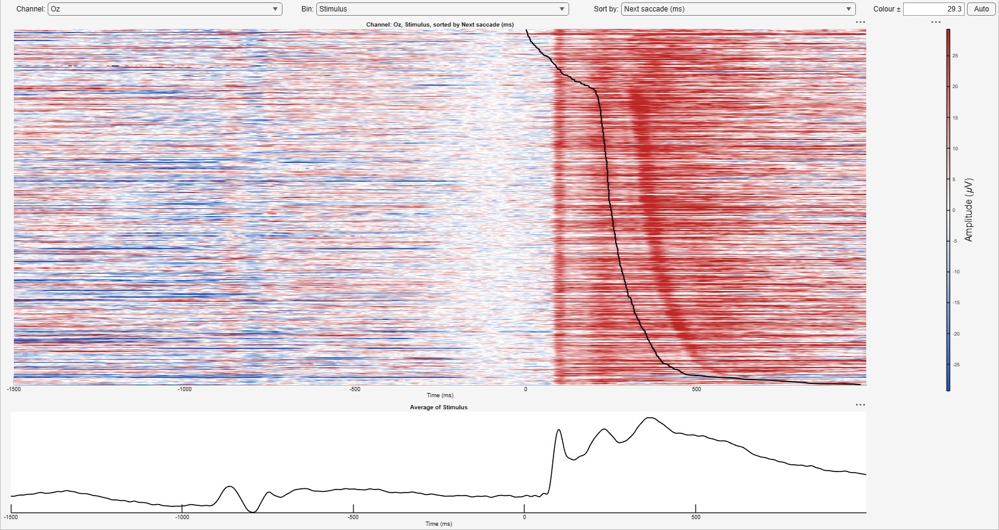
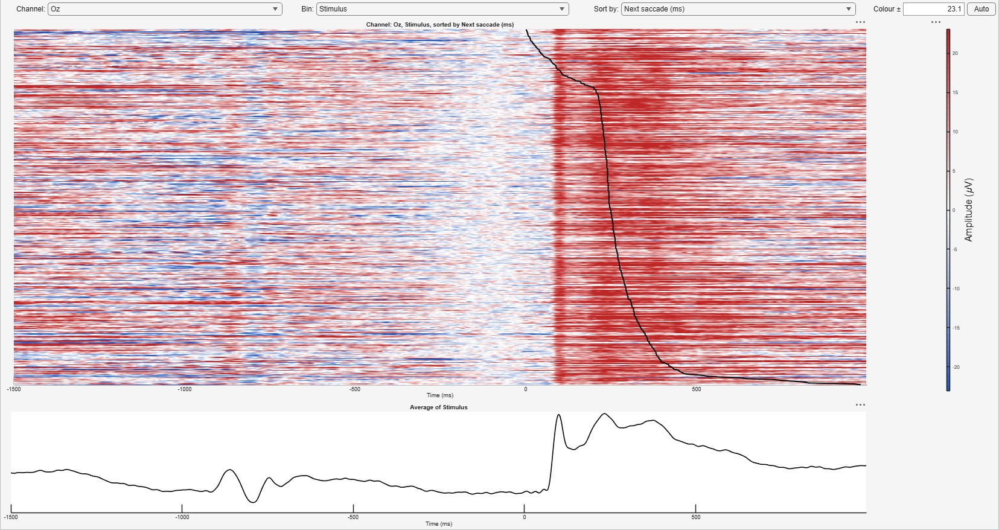
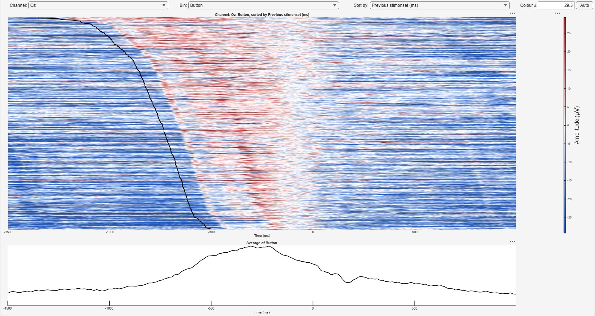
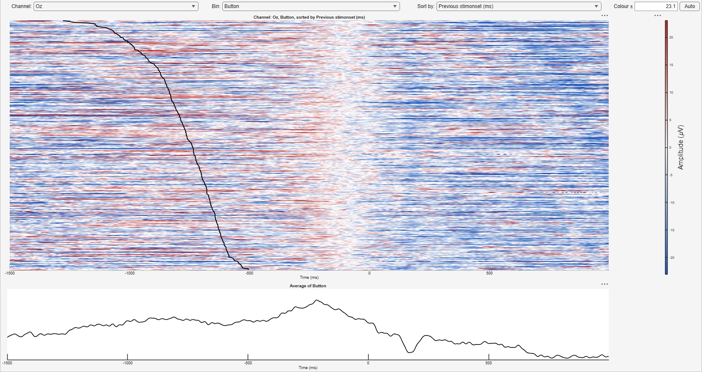
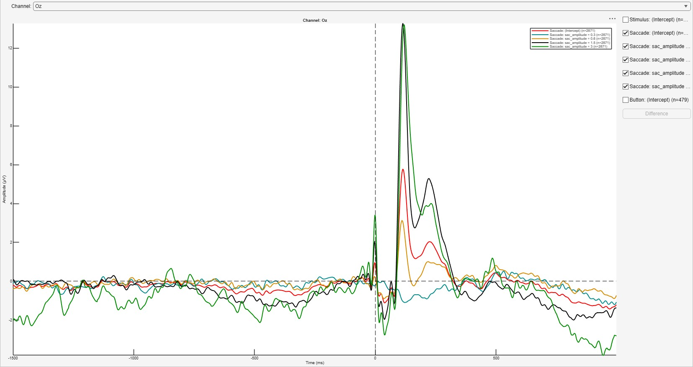

*Tools > 3. Epoching and Averaging > Deconvolve · continuous → averaged,
epoched, or averaged terms · `Deconvolve`*

The alternative to epoching and averaging where responses overlap. Averaging
assumes that each epoch holds the response to its own event and nothing
else. When events follow each other faster than a response decays, in
reading, free viewing, fast presentation or with a response after every
stimulus, the same samples carry the end of one response and the start of
the next, and each bin's average carries a smear of its neighbours'.
Deconvolve fits all bins at once against the whole continuous recording, as
a linear regression on a time-expanded design matrix, so that a sample
explained by two events is shared between them [@smith2015; @ehinger2019;
@dimigen2021]. The fitting is done by the Unfold toolbox [@ehinger2019].
@sec-deconvolution works through a complete example on published data.

{#fig-deconvolve-dialog}

| Option | Default | Meaning |
|-------------------------------------------------------|--------------------------|-------------------------------------------------------|
| **Define bins** | the dataset's own bin tags | The bins, in DefineBins' language and editor. An `epoch` line is ignored: the fit uses the continuous recording, and **Window** sets the response window. |
| **Window** start, stop | -200, 800 ms | The response window fitted around every event. |
| **Baseline** start, stop, **Baseline-correct the result** | off; the pre-event window offered | Off, the waveforms are the betas as fitted, as Unfold returns them. On, they are baseline-corrected over the window, taken as Unfold's `uf_plotParam` takes a baseline: from its start up to, but not including, its stop. |
| **Result** | One waveform per bin | **One waveform per bin** (shaped like Average), **overlap-corrected trials** (shaped like DefineBins' epochs), or **the model's terms**. |
| **Terms evaluated at** | ten quantiles | For the terms: where continuous and spline terms are evaluated, as `sac_amplitude = 0.5 1 2; rt = 300 500`. A term not named is evaluated at ten quantiles of its own values, the toolbox's default. |
| **A term not named, at** | ten quantiles of its values | For the terms: where a continuous or spline term not named in **Terms evaluated at** is evaluated: ten quantiles of its values (the toolbox's default), ten values evenly spaced from its minimum to its maximum, or its mean alone (Unfold's `uf_predictContinuous`). |
| **Other terms added at** | their mean value (MEM) | For the terms: how each term's waveform carries the model's other terms, at their mean value (MEM, the toolbox's default) or as their average marginal effect (AME). |
| **Formula** per bin | `y ~ 1` | What explains the bin's response, in Unfold's notation (below). |
| **Factors coded as** | reference | How a factor (`cat()` in a formula) is coded, by Unfold's `uf_designmat`: reference coding, where the intercept is the first level (the toolbox's default), or effects coding, where it is the mean over the levels and each continuous term is centred on its events' mean. A bin's waveform is the same either way; the model's terms differ. Effects coding with an interaction of a factor and a continuous term is refused (the waveform cannot hold that term at its pooled value). |
| **Events in no bin, modelled and dropped** | all | Event codes outside the bins to model as nuisance, so that their overlap is removed too. |
| **Artefact threshold**, **Measured in a window of**, **Stepped by** | 150 µV, 2000 ms, 100 ms | Stretches whose peak-to-peak amplitude in the moving window exceeds the threshold are left out of the model; 0 turns this off. |
| **Artefact scan on** | every channel | The channels the scan looks at: every channel, as the toolbox scans, or the scalp EEG only. |
| **Missing values** | filled in with the median | An event without a number its formula uses: filled in with the median, the mean or a random one of its bin's other values, or the event left out of the model, by Unfold's `uf_imputeMissing`; or refused. |
| **Around cuts** | fitted as they are | What happens either side of a cut in the recording (a boundary event): fitted as it is, across the join, as the toolbox does; or the longer side of the response window left out on each side, so that no event's window is fitted across two moments that were never adjacent. A trial whose window spans a cut is left out either way. |
| **Overlap correction** | on | On: the bins fitted against the continuous recording (deconvolution). Off: the same formulas fitted to epochs, without the neighbours' overlap taken out (below). |
| **Time basis** | one beta per sample | How each response is spread over the window, by Unfold's `uf_timeexpandDesignmat`: one beta per sample (the toolbox's default), or a number of cubic splines or Fourier frequencies (30 unless changed), which share their betas between neighbouring samples and give smoother waveforms from fewer parameters. With overlap correction, and not for the trials (below). |
| **Solver** | the toolbox's default | lsmr (on epochs, pinv); MATLAB's exact solver; or glmnet's regularised fit (below). |
| **Solver iterations** | 400 | The most iterations lsmr takes per channel, the toolbox's own limit. A fit that reaches it says so. |
| **glmnet alpha** | 1 | For glmnet: 1 is lasso, 0 ridge, between them elastic net. |
| **Collinearity (VIF)** | not checked | The variance inflation factor of every column of the time-expanded design, by Unfold's `uf_vif`: how hard the overlap makes it to tell the bins apart (with overlap correction only; long windows need much memory). Each term's largest is in the notes; the toolbox notes that splines give high values that are usually no problem. |
| **Model fit** | not measured | How much of the recording the model explains, per channel, by Unfold's `uf_checkmodelfit` (with overlap correction only): R², the partial R² of each term (the model refitted without it), or either cross-validated (each fold fitted on the rest). The summary is in the notes and the data-quality report. |
| **Folds cut at** | none | For a cross-validated fit: the event code the recording is cut into folds at, such as the breaks between blocks. The toolbox refuses a code that falls where an event's response is modelled. |
| **Trials made by** | Alakazam | For overlap-corrected trials: Alakazam's own arithmetic, or the toolbox's `uf_erpimage`, channel by channel, the same trials far later on a long recording (below). |

: Deconvolve's options. {#tbl-deconvolve}

## Formulas

Each bin has a formula in Unfold's Wilkinson notation. The dialog lists the
event fields a formula can use, by kind, with their counts, and shows the
columns the toolbox builds for each formula before anything is fitted.

| Formula | Meaning |
|---------------------------------|-------------------------------------------------------|
| `y ~ 1` | the bin's own waveform, nothing else |
| `y ~ 1 + rt` | plus a waveform that scales linearly with `rt` |
| `y ~ 1 + spl(rt, 5)` | plus a smooth, non-linear effect of `rt`, with 5 spline functions |
| `y ~ 1 + circspl(angle, 5, 0, 360)` | a circular spline, for an angle |
| `y ~ 1 + cat(side)` | a factor, coded against its first level |
| `y ~ 1 + cat(side) * rt` | a factor, a linear term and their interaction |
| `y ~ 1 + 2dspl(x, y, 5)` | a smooth surface over two fields, such as a fixation's position |

: Formulas in Unfold's notation. {#tbl-deconvolve-formulas}

**A term is a control.** Every bin's waveform is the model's prediction with
each continuous and spline term held at the same value for every bin (for a
spline, over the range the bins share), and each factor at the bin's own mix.
An interaction with a continuous term is held at the same value too. So a
reaction time or saccade size that differs between bins does not appear as a
difference between them, which is the point of including it
[@dimigen2021].

**Bins may share events**, as they may for Average: an event counts in every
bin it belongs to. A bin nested in another ("Rare" inside "All stimuli") is
then the response of its own events, and the outer bin the average over all
of its events. Internally each set of bins that some events share is fitted
as one event type, with the terms of all those bins' formulas, and the model
list says which bins share events.

**An event without a number** its formula uses is handled as **Missing
values** says, by Unfold's own `uf_imputeMissing`, between building the
design and fitting it, as the toolbox's workflow places it. The median, the
mean or a random draw is taken from the bin's other events, and the filled-in
value is fitted; a waveform per bin is still held at the values the events
have. Leaving the events out (drop) leaves them out of the overlap
correction too: their responses stay in the recording, unmodelled, and the
bins count, average and cut trials without them. The model list says how
many events lack which field. A factor needs a level on every event of the
bin, whatever is chosen: the toolbox cannot build a factor with an event
that has none, and `uf_imputeMissing` fills in numbers.

## What to model

Overlap is removed only where it is modelled. A response to an event outside
the bins still overlaps the bins' responses unless that event is modelled as
nuisance, which is why **Events in no bin** defaults to all of them. There is
one exception, and the dialog's list is where to decide it: an event that
follows another at a nearly constant lag (a fixation 12 ms after its
saccade, or a trial-start marker a fixed time before each stimulus) cannot be
told apart from it, and modelling both makes the regression ill-conditioned,
so that the solver may fail to converge. Model one of the pair.

The dialog finds such pairs for you. When an event in no bin that is ticked
keeps a nearly constant lag to a bin or to another ticked event, for most
events of both, with a spread under 20 ms and close enough for their
responses to overlap, the model lists a warning that names the two and the
lag, and an alert says so whenever the choice creates one. Unticking the
event clears it; its response then stays in the bin's waveform, as it would
in an average. The warning does not stop **OK**, and the fit notes it too,
naming the pair as the likely cause if the solver then does not converge.

**Artefacts** are handled by leaving stretches out of the model rather than
by dropping epochs, so an event next to a bad stretch keeps the rest of its
data. The defaults are the toolbox's, every channel scanned. An eye
channel's range is several times the EEG's, so where the eye channels are in
the recording, scanning **the scalp EEG only** leaves out far less of it; the
eye channels are still fitted. In reading and free viewing, where the eye
movements are the task, it is usually better to set the threshold to 0 and
model the saccades and blinks instead.

## The three results

- **One waveform per bin** has Average's shape, so ERP Measure, scalp maps,
  grand averages and the reports read it unchanged. A fitted waveform has no
  trial-to-trial standard error of its own.
- **Overlap-corrected trials** are one epoch per binned event, shaped like
  DefineBins' epochs, each the recording around its event with every other
  event's fitted response subtracted: the trials Unfold's own `uf_erpimage`
  makes, its modelled responses plus residuals, computed by Alakazam at the
  trials' own samples unless **Trials made by** asks for the toolbox's call
  (see Long recordings, below). Averaging them
  returns the fitted waveforms; what they add is the trials themselves, for
  an ERP image without the overlap ([The plot area](https://markspan.github.io/Alakazam/#sec-plot-area)) and for the data-quality
  report's measures of trial-to-trial noise. A trial whose window touches a
  stretch left out of the model had nothing subtracted there and is dropped,
  and counted. The toolbox cannot make them for a glmnet fit (below).
- **The model's terms**: every factor level, and every continuous or spline
  term at chosen values, each as a whole waveform with the model's other
  terms added in (Unfold's `uf_predictContinuous` and `uf_addmarginal`).
  **Other terms added at** decides how: at their mean value (MEM, the
  toolbox's default), or as their average marginal effect (AME), a spline
  averaged over its events' own values, as **One waveform per bin** has it.
  The two differ only for a spline, and most for a circular one: the mean of
  angles near 0 and 360 degrees is a direction no event had. A 2D spline is
  named by both fields in **Terms evaluated at** (`x = 1 2; y = 0.5`).

With overlap correction, Deconvolve needs continuous data without a DC
offset, since the regression has no intercept for the recording as a whole:
high-pass filter first.

### Long recordings

On a long recording with many events, two steps take most of the time. The
busy indicator shows how far the trials have got, and the fit when it runs
on parallel workers (one after another, the toolbox fits every channel in a
single call, which reports no progress).

- **The fit** solves one channel after another. With the default solver
  (lsmr) and a large job, the channels are fitted on parallel workers, each
  running the toolbox's own `uf_glmfit` on its channel. The result is the
  same to rounding error (a worker computes on one thread and sums some
  terms in another order), and a channel that ran out of iterations still
  says so.
- **The overlap-corrected trials**: by default (**Trials made by:
  Alakazam**) they are computed only at the trials' own samples and for
  every channel at once: the recording less the model's prediction there,
  plus the event's own fitted response, with the events kept and the
  windows cut as `uf_epoch` and EEGLAB's `pop_epoch` keep and cut them. It
  agrees with the toolbox's trials to rounding error, with cuts, stretches
  left out, covariates and splines, but it is Alakazam's arithmetic rather
  than the toolbox's call. **Trials made by: the toolbox** calls
  `uf_erpimage` for each channel instead, which epochs the whole recording
  around every modelled event, three times, and on a long recording with
  many events adds up to a long wait; on a large job the channels go to
  parallel workers. Settings and templates stored before the choice
  existed make their trials Alakazam's way.

Parallel workers are used only when the job is large enough to repay
starting them (which takes a while the first time), when the Parallel
Computing Toolbox is installed, and when **Process recordings in parallel**
is checked in Alakazam's **Settings** (Processing). How many: as many as the
cores and the free memory allow. A pool already running is used as it is.
Under **Apply to All Raw Files**, where each recording already has a worker
of its own, Deconvolve does its channels one after another on that worker.

## Without overlap correction, and the solvers

**Overlap correction off** fits the same bins and formulas the toolbox's
other way, a regression on epochs (Unfold's `uf_epoch` and
`uf_glmfit_nodc`): each event's window on its own, the neighbours' overlap
left in. With `y ~ 1` a bin is then the mean of its epochs, as Average
gives it, except that the toolbox rounds each event to the nearest sample
where DefineBins takes the sample at or before it. With a formula it is the
regression without deconvolution, which is what Unfold compares a
deconvolution with. An epoch that touches a stretch the artefact scan
marks, spans a cut or runs off the recording is left out, and counted; the
trials are the epochs as they were cut. A DC offset is no obstacle here,
since every sample of an epoch has its own intercept.

**Solver** chooses how the fit is solved. The toolbox's default is lsmr, an
iterative solver (pinv on epochs). The exact solver, MATLAB's own, needs no
iteration limit but, as the toolbox warns, can need tens of gigabytes of
memory for a long recording. glmnet fits a regularised model, its strength
chosen by cross-validation: its betas are shrunk towards zero, and lasso
(**glmnet alpha** 1) sets some to exactly zero, so the waveforms are no
longer the least-squares ones. With overlap correction a glmnet fit gives
no overlap-corrected trials (below), so that combination is refused. The
toolbox's other two methods are not offered, since its own help advises
against them.

**Settings stored before these choices existed.** A template saved before
**Artefact scan on**, **Other terms added at** and **Missing values** were
settings (with V0.4.5 or earlier) was run with the scalp EEG only, AME and
missing numbers refused, and replays and reopens with them, so it gives the
result it always gave. One saved before **Around cuts** was a setting (with
V0.4.5.2 or earlier) left a window out around every cut, and still does. Without **Overlap correction** or **Solver** it is a
deconvolution by lsmr, as it always was.

## How the Unfold toolbox is called

The technical note [*Deconvolve and the Unfold
workflow*](https://github.com/markspan/AlakazamDeconvolve/blob/main/docs/unfold-technical-note.md)
goes through the toolbox's own account of its workflow step by step: which
function Deconvolve calls, with which settings, what it adds before and
after, and every place it departs from a toolbox default.

Deconvolve calls the Unfold toolbox as an Unfold script does, with the same
inputs, starts from its defaults, and keeps its results as they are, so a
result is the one Unfold itself gives. The artefact scan, for example, is
handed the dataset's own events, cuts included, and looks at each stretch
between cuts on its own.
Eight details of the toolbox are worth knowing (Unfold 1.3.1, unchanged in its
current version):

- **Joining marked stretches.** `uf_combineWinrej` joins overlapping marked
  stretches by ending the joined one where the later-starting one ends.
  Where one stretch lies wholly inside another, the joined stretch ends with
  the inner one, and the rest of the outer one is fitted. It arises only
  where two sets of marks are joined and one lies inside the other. In
  Deconvolve those are the scan's marks and, with **Around cuts** set to
  leave a window out, the zones around cuts, and it needs an artefact window
  shorter than the longer side of the response window, which the defaults
  are not.
- **One-letter factor levels.** `uf_designmat` gives an empty event field the
  value NaN, so that a numeric field stays numeric, and MATLAB's
  `struct2table` then reads levels that are all single letters, together
  with NaN, as characters rather than text. The design cannot then be built.
  It needs levels that are all single letters and an event without the
  field; name the levels with two letters or more ([Troubleshooting](#troubleshooting)).
- **The scan's edges.** ERPLAB's moving window, which the toolbox uses,
  starts one sample in and stops when the next step would run off the end,
  so the first sample and less than one step at the end of each stretch are
  not looked at.
- **Zeros in a covariate.** The mean and quantiles of a continuous term leave
  out values that are exactly zero, as the toolbox's own message says, since
  zero is what the rows of the other event types hold. A covariate whose own
  values include zero (a rating of 0) is summarised without them; name the
  values in **Terms evaluated at** where that matters.
- **Filling in missing values.** `uf_imputeMissing` fills in a spline's
  columns one by one, so a filled-in event's row is not the spline at any one
  value; its warning that more than 5% of a predictor is missing counts
  against every event in the model, not the bin's own; and its random draw
  (marginal) stops when two predictors miss different numbers of values,
  since it reuses one list of drawn values from predictor to predictor.
  Deconvolve then says so; choose the median, the mean or drop instead.
- **Trials at the nearest sample.** `uf_erpimage` cuts its trials with
  `uf_epoch`, which rounds each event to the nearest sample. Where events
  fall on the same sample it keeps one trial for them, which holds the
  fitted response of the one earlier in the recording's event list but is
  labelled by the one it finds first by type. Its output does not say which
  is which, so an event that shares its sample with another has no trial;
  Deconvolve counts them and says so in its notes.
- **No trials from a time basis.** `uf_erpimage` multiplies the design, whose
  columns are splines or frequencies with such a basis, by betas already
  turned back into samples, and the two do not match. Deconvolve refuses a
  time basis with overlap-corrected trials before fitting, and says why.
- **No trials from glmnet.** `uf_erpimage` asks for a beta of every column of
  the design, and glmnet adds a column of its own, an intercept for the whole
  recording, whose beta `uf_condense` does not return. Deconvolve refuses
  glmnet with overlap-corrected trials before fitting, and says why; choose
  another solver for the trials, or ask glmnet for the waveforms or terms.

## Troubleshooting

**Deconvolve warns that the solver did not converge.** The design is close to
collinear: often two event types at a nearly constant lag are both modelled
(a fixation and the saccade just before it, a trial marker and the stimulus
a fixed time later), or a formula has more terms than its events support.
Model one of each such pair ([What to model](#what-to-model)). The Deconvolve dialog warns
about such pairs before the fit, and the warning after it names them. Where
the design is sound and the fit is merely slow to settle, raise **Solver
iterations** (400 by default, the toolbox's own limit).

**Deconvolve says Unfold cannot build the design: "expected to be a cell
array, was char".** The Unfold toolbox (1.3.1) cannot build a factor whose
levels are all single letters (`L`, `R`) once another event type in the model
lacks that field: MATLAB's `struct2table` then reads the levels as characters
rather than as text. Give the levels longer names (`left`, `right`); the
message names the factor.

**Deconvolve says the toolbox could not draw the missing values.** With
**Missing values** set to a random draw (marginal), the Unfold toolbox (1.3.1)
stops when two predictors miss different numbers of values: it reuses one
list of drawn values from predictor to predictor. Choose the median, the mean
or leaving the events out instead; the message names the fields and how many
values each lacks.

**Deconvolve refuses a factor some events have no level of.** The Unfold
toolbox cannot build a factor with an event that has no level of it, and
**Missing values** fills in numbers, not levels. Give those events a level,
or leave the factor out of that bin's formula.

## Overlap correction by deconvolution {#sec-deconvolution}

When events follow each other faster than a brain response decays, the
average of one event's epochs contains parts of the responses to its
neighbours. For saccades during visual search, @dandekar2012 showed that
averages are systematically distorted by this overlap, and recovered the
responses with a general linear model instead. Deconvolve
(described above) separates them with such a regression, fitting every
event's response at once on the continuous recording [@smith2015;
@ehinger2019; @dimigen2021]. This
chapter works through a
complete analysis on published data: Figure 11 of the Unfold toolbox paper
[@ehinger2019], rebuilt from the authors' own recording with a template that
comes with this plugin (`FaceSaccadesDeconvolution.alztemplate`, in the
`templates` folder of the installed plugin, which **Show folder** in
**Install plugins** leads to). How
Deconvolve calls the toolbox, step by step against the toolbox's own
workflow, is in the technical note [*Deconvolve and the Unfold
workflow*](https://github.com/markspan/AlakazamDeconvolve/blob/main/docs/unfold-technical-note.md).

### The data

One participant of a face-discrimination task recorded by the authors. A
face was shown for 1350 ms and the participant pressed a button to judge its
emotion; although told to keep fixating, they made small involuntary saccades
towards the mouth of the face. Every trial therefore holds three overlapping
responses: to the face (`stimonset`), to each saccade (`saccade`, the first a
median 250 ms after the face) and to the button press (`buttonpress`, a
median 750 ms after the face). The recording, 40 channels at 500 Hz including
the eye electrodes IO1, IO2, LO1 and LO2, and the authors' own script are on
the paper's OSF page (osf.io/wbz7x); they are not part of the repository. The
authors' script calls the figure "Figure 10", its number in the preprint.

### The template

Select the recording, right-click and **Apply Template**, choosing the
template. It adds two nodes:

- **Deconvolve**, returning overlap-corrected trials (**Result**:
  Overlap-corrected trials), with the paper's model:
  - three bins, one per event type (`bin 1 "Stimulus" "stimonset"`, `bin 2
    "Saccade" "saccade"`, `bin 3 "Button" "buttonpress"`);
  - a response window from -1500 to 1000 ms around each event;
  - every stretch whose peak-to-peak amplitude exceeds 250 µV in a moving
    2 s window on the scalp channels (**Artefact scan on**: the scalp EEG
    only) left out of the model (13.5% of this recording);
  - a formula per bin: `y ~ 1` for the face and the button press, and
    `y ~ 1 + spl(sac_amplitude, 5)` for the saccade, since larger saccades
    are followed by larger lambda responses, and not in a straight line.

  No event outside the three bins is modelled, as in the paper. The data
  show why: a fixation begins 12 ms after its saccade (SD 6 ms), and the
  `S 99` marker precedes each face by about 1010 ms (SD 6 ms). Lags so nearly
  constant cannot be told apart from the saccade's and the face's own
  responses, and modelling them makes the regression ill-conditioned.
- **Average** of those trials: the deconvolved response to each event type,
  within 0.3 µV of the waveforms the model fits.

The figure sets the deconvolved responses beside those of plain epoching,
and the paper goes on to how the saccade's size matters. Three more steps on
the same recording give the rest of this chapter:

- **Deconvolve** again, with the same settings and **Result**: One waveform
  per bin, for the waveforms the model fits;
- **DefineBins** with the same three bins, epoched from -1500 to 1000 ms,
  then **Baseline** (-200 to 0 ms), **ArtefactDetect** (the same 250 µV
  moving-window peak-to-peak criterion, on the scalp channels) and
  **Average**: the comparison without deconvolution;
- **Deconvolve** a third time, with **Result**: One waveform per model term,
  the saccade spline evaluated at amplitudes of 0.3, 0.6, 1.5 and 3 degrees
  (**Terms evaluated at**: `sac_amplitude = 0.3 0.6 1.5 3`), and the other
  terms added as their average marginal effect (**Other terms added at**:
  AME).

Built by hand, the first node is **Tools > 3. Epoching and Averaging >
Deconvolve**, with the bins written under **Define bins** and the formulas
typed into the table. Before anything is fitted, the model list shows what the
toolbox makes of each formula: the saccade's five splines become four
columns, since one is already covered by the intercept (@fig-deconvolve-dialog).

### Figure 11, top row: the waveforms

Select the Deconvolve node that returns one waveform per bin and drag the
plain **Average** onto it: an average dropped on another of the same shape
is drawn in the same plot rather than transformed. Pick Oz and untick everything but the two stimulus
waveforms.

{#fig-deconvolve-waveforms}

The two agree for the first 300 ms after the face (within 0.7 µV) and then
part: between 300 and 500 ms the plain average peaks at 23.6 µV and the
deconvolved waveform at 17.7 µV. About a quarter of what looks like a P300
to the faces belongs to the microsaccades and the button press, which is the
paper's point. Ticking the saccade or the button pair instead gives the
other two panels of the row. On the same recording, the authors' own script
gives a stimulus waveform at Oz that correlates with this one at
*r* = 0.9998 from -200 to 1000 ms, with a largest difference of 3.2 µV;
where the analysis departs from the authors' is listed at the end of the
chapter.

### Figure 11, bottom row: the single trials

Select the **Baseline** node (the plain epochs) and, in its ERP image, pick
Oz, the **Stimulus** bin and **Sort by: Next saccade**. Each row is one
trial, ordered by when the first saccade came, and that moment is drawn
across the image ([The plot area](https://markspan.github.io/Alakazam/#sec-plot-area)). The response to the face runs straight
down at a fixed latency; the lambda response to the saccade follows the
line.

{#fig-deconvolve-stimulus-plain}

The same settings on the template's Deconvolve node, the overlap-corrected
trials, leave the face's response alone:

{#fig-deconvolve-stimulus-corrected}

The button press shows it most plainly. In the **Button** bin, sorted by
**Previous stimonset**, the plain epochs carry the face's response along the
line, further back the longer the participant took to respond; in the
corrected trials nothing follows the line:

{#fig-deconvolve-button-plain}

{#fig-deconvolve-button-corrected}

The **Saccade** bin sorted by **Next buttonpress** gives the remaining panel
(Figure 11D). Each corrected trial is the recording around its event with
every other event's fitted response subtracted, as the Unfold toolbox's own
`uf_erpimage` makes them (computed by Alakazam, the default; the toolbox's
call gives the same trials, more slowly). 3323 of the 3829 events keep a trial: a window that touches a
stretch left out of the model had nothing subtracted there, and is dropped;
and a few button presses and faces fall on the very sample of a saccade,
where the toolbox keeps one trial for the two, so they have none. The
template's Average of the kept trials
comes within 0.3 µV of the fitted waveforms; its stimulus response peaks at
17.9 µV between 300 and 500 ms at Oz, where the fitted waveform peaks at
17.7 µV.

### Beyond the figure: how saccade size matters

The third Deconvolve node returns the model's own view of the saccade term: the saccade
response at each amplitude asked for, each a whole waveform with the other
terms as their average marginal effects (Unfold's `uf_predictContinuous` and
`uf_addmarginal`). With AME the intercept is the response averaged over this
participant's saccades; with the toolbox's default, MEM, it would be the
response to a saccade of the mean amplitude.

{#fig-deconvolve-terms}

At Oz, the lambda response, 50 to 150 ms after saccade onset, peaks at
-0.3, 3.1, 13.3 and 13.2 µV for saccades of 0.3, 0.6, 1.5 and 3 degrees. It
grows with amplitude and then levels off: the non-linearity that is the
paper's reason for a spline. The median saccade here is 0.6 degrees, on the
steep part of the curve, which is why the saccade's contribution to the
stimulus-locked average depends so much on how large this participant's
microsaccades were.

### Where it differs from the paper

- The artefact scan covers the 36 scalp channels, where the authors' script
  scans all 40, the eye electrodes included, as the toolbox does by default
  (**Artefact scan on**: every channel); an eye channel's range is several
  times the EEG's, so scanning it leaves out far more of the recording.
- One baseline, -200 to 0 ms, serves every bin, where the authors' script
  baselines the button-locked panels at 400 to 600 ms.
- The saccade takes five splines, as the paper says; the authors' script
  uses ten.
- Panels A and B, the trial timeline and a heat map of saccade end points,
  are not ERPs and are not reproduced.

### Applying it to your own data

- Model every event type whose response overlaps the ones of interest, but
  only one of any pair locked at a near-constant lag
  ([What to model](#what-to-model)).
  A warning that the solver "did not converge" is a sign of a nearly
  collinear design; such a pair, modelled together, is one cause, and a
  formula with more terms than its events can support is another.
- Let the formula carry what differs between conditions and is not the
  effect of interest (reaction time, saccade size): a term is held at the
  same value for every bin, so it cannot masquerade as a condition effect
  [@dimigen2021].
- In free viewing and reading, where eye movements are the task, set the
  artefact threshold to 0 and model the saccades and blinks instead; the
  eye-tracking join ([Eye tracking](https://markspan.github.io/AlakazamEyetracking/)) supplies them as events with their
  amplitudes, durations and positions.
